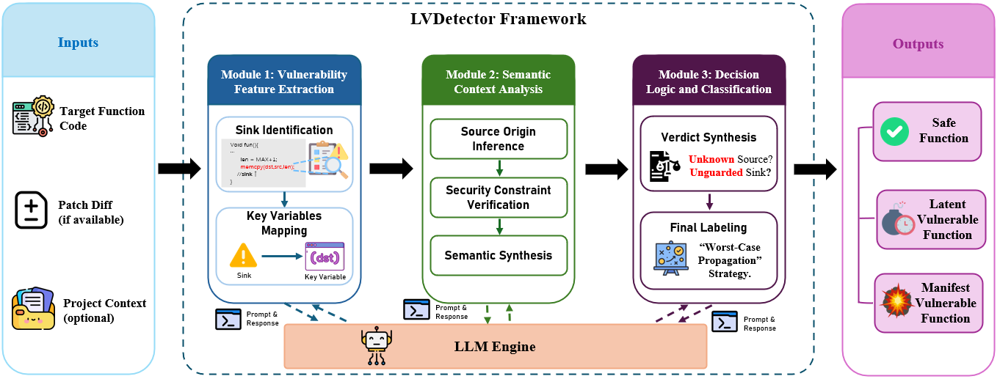

# LVDetector: Latent Vulnerability Detection via Multi-Module Reasoning

A framework for detecting **latent vulnerabilities** in C/C++ source code using a Chain-of-Thought (CoT) prompting pipeline. The system decomposes the vulnerability analysis into three independent modules, enabling fine-grained semantic reasoning over function-level code.

> This folder is self-contained: it holds the package modules, entry point,
> tests, datasets, and documentation. Keep the folder name `lvdetector`,
> because all internal imports use the `lvdetector.` package prefix.

## Pipeline Overview



## Project Structure

```
lvdetector/
├── main.py                          # CLI entry point
├── __init__.py
├── README.md
├── fig/                             # README figures
├── config/
│   ├── __init__.py
│   └── settings.py                  # API config, prompts, runtime defaults
├── domain/                          # Enums and records (CodeSample, StepOutput, ...)
├── prompts/
│   └── registry.py                  # Verbatim prompt registry
├── llm/
│   ├── base.py                      # LLMPort protocol + LLMConfig
│   └── openai_client.py             # Lazy OpenAI-compatible adapter
├── parsing/                         # Tolerant parsers for Steps 1-7
├── modules/
│   ├── feature_extraction.py        # Module 1 (Steps 1-2, Risk Anchoring)
│   ├── context_analysis.py          # Module 2 (Steps 3-6, Semantic Reasoning)
│   └── decision_logic.py            # Module 3 (Step 7, Global Synthesis)
├── pipeline/
│   ├── context.py                   # AnalysisContext helpers
│   └── orchestrator.py              # Sequential module execution
├── datasets/                        # Read-only JSON/folder loaders
├── evaluation/                      # Binary metrics + offline worst-case helper
├── io/                              # JSON/JSONL result writers
├── services/                        # AnalysisService + BatchRunner (Pool + tqdm)
├── cli.py                           # argparse CLI
├── testdata(RQ1)/                   # RQ1 groundtruth datasets (read-only)
├── testdata(RQ3)/                   # RQ3 experimental datasets (read-only)
├── requirements.txt                 # Runtime dependencies
├── .gitignore
└── outputs/                         # Analysis results
```

## Architecture

The analysis is organized as three layers and seven sequential steps. Every
step is a separate LLM call over the same growing conversation.

| Layer | Module | Steps |
|-------|--------|-------|
| Risk Anchoring | `FeatureExtractionModule` | 1. Sink identification (over-approximation) → 2. Key-variable mapping |
| Semantic Reasoning | `ContextAnalysisModule` | 3. Source inference → 4. Guard verification → 5. Semantic synthesis → 6. Patch alignment |
| Global Synthesis | `DecisionLogicModule` | 7. Function-level JSON decision |

Design invariants:

- `lvdetector/config/settings.py` is the only source of prompt text;
  `PromptRegistry` reads those constants directly and interpolates only
  Step 1's `{code}`. Step 4's `{KEY_VARS}` placeholder is intentionally left
  literal.
- The conversation sent to the model is fixed: system + seven user/assistant
  pairs (15 messages) in Step 1-7 order.
- Parsed artifacts (sinks, variables, dependencies, patch relations) are
  recorded on the side and never modify prompts or messages.
- The final label and category come exclusively from Step 7. The
  `evaluation.worst_case_label` helper exists for offline paper-style
  analysis only and is not part of the decision path.
- `main.py` exposes `analyze_stepwise` and `get_single_result`; the CLI is
  implemented in `lvdetector/cli.py`.

## Datasets

### `testdata(RQ1)` — RQ1 Groundtruth Datasets

Human-annotated groundtruth for evaluating vulnerability detection on real-world CVE functions. Each JSON file contains code samples with verified vulnerability labels.

| File | Samples | Description |
|------|---------|-------------|
| `primeVul_0_groundtruth(385).json` | 385 | PrimeVul non-vulnerable (label=0) |
| `primeVul_1_groundtruth(346).json` | 346 | PrimeVul vulnerable (label=1) |
| `diverseVul_0_groundtruth(385).json` | 385 | DiverseVul non-vulnerable (label=0) |
| `diverseVul_1_groundtruth(369).json` | 369 | DiverseVul vulnerable (label=1) |
| `bigVul_0_groundtruth(385).json` | 385 | BigVul non-vulnerable (label=0) |
| `bigVul_1_groundtruth(346).json` | 346 | BigVul vulnerable (label=1) |

### `testdata(RQ3)` — RQ3 Experimental Datasets

Datasets constructed for the RQ3 experiment, designed to evaluate latent vulnerability detection at scale.

- **`*_all_*`**: Contains functions with **latent vulnerabilities** (labeled as "all" — includes all original vulnerable functions).
- **`*_without_*`**: Contains the same functions **after removing latent vulnerability samples** (only non-latent vulnerable + safe functions remain).

| File | Samples | Description |
|------|---------|-------------|
| `test/primevul_all_test.json` | 2,000 | PrimeVul test set — includes latent vulns |
| `test/primevul_without_test.json` | 2,000 | PrimeVul test set — latent vulns removed |
| `test/diverseVul_all_test.json` | 2,000 | DiverseVul test set — includes latent vulns |
| `test/diversevul_without_test.json` | 2,000 | DiverseVul test set — latent vulns removed |
| `test/devign_all_test.json` | 2,000 | Devign test set — includes latent vulns |
| `test/devign_without_test.json` | 2,000 | Devign test set — latent vulns removed |
| `train&val/all_train.json` | 13,900 | Mixed-source training set — includes latent vulns |
| `train&val/all_val.json` | 1,737 | Mixed-source validation set — includes latent vulns |
| `train&val/all_test.json` | 1,739 | Mixed-source test set — includes latent vulns |
| `train&val/without_train_third.json` | 13,900 | Mixed-source training set — latent vulns removed |
| `train&val/without_val_third.json` | 1,737 | Mixed-source validation set — latent vulns removed |
| `train&val/without_test_third.json` | 1,739 | Mixed-source test set — latent vulns removed |


## Setup

### Requirements

- Python 3.10+
- OpenAI-compatible API key (DeepSeek, OpenAI, etc.)

### Installation

```bash
pip install -r requirements.txt
```

### Configuration

Edit `config/settings.py`:

```python
API_KEY = "your-api-key-here"
BASE_URL = "your-url-here"   # or other compatible endpoint
MODEL = "your-model-name"               # e.g., "deepseek-chat"
```

## Usage

Run the commands below from inside this folder.

### Process a JSON dataset

```bash
python main.py --json "testdata(RQ1)/diverseVul_0_groundtruth(385).json"
```

Results are written to `outputs/analysis_result.json`. The built-in default
input sample ships inside `testdata(RQ1)/`, so the command below
also works without arguments:

```bash
python main.py
```

### Process individual C files from a folder

```bash
python main.py --folder /path/to/c/files
```

### Analyze with patch diff context

```bash
python main.py --json data.json --diff fix.patch
```

